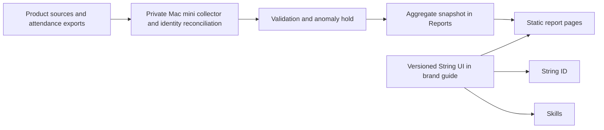

# Implementation Plan: Current and Consistent String Impact Reports

**Branch**: `codex/reports-maintenance-plan` | **Date**: 2026-10-25 | **Spec**: [spec.md](spec.md)

**Input**: Feature specification in `specs/001-refresh-impact-reports/spec.md`.
**Status**: Planning complete for review; implementation and activation are not authorised by this document.

## Summary

Add one reporting data boundary: a versioned public snapshot generated by a private daily
pipeline on the Mac mini. Keep the existing static report routes and editorial catalogue.
Publish separate all-time unique product-user and event-participant counts with explicit
coverage. Share UI through one package in the existing String brand-guide repository.



Collection is local outbound access using read-only source permissions. No new publicly
reachable collector, database credential or private admin response is needed. The public
snapshot is intentionally public; its fields are aggregate-only.

## Technical Context

**Language/Version**: TypeScript; Node 24 LTS for the local runner, pinned patch at implementation.

**Primary Dependencies**: Existing Reports Next 16.2, React 19.2, Tailwind 4.2 and Zod 3;
read-only Postgres client for mapped sources. Prefer file-based local normalized state for
the initial source volume; no new database service. Source DB clients are runner-only.

**Storage**: Restricted local state outside every Git checkout, keyed per source record;
only normalized identity evidence, eligibility and action timestamps necessary for counting.
Public `data/reports.snapshot.json` is the interface consumed by the site.

**Testing**: Small deterministic fixtures for identity/period/publication contracts;
source query reconciliation; consumer build/type checks; browser/keyboard/visual checks.
No source personal records in fixtures or public CI.

**Target Platform**: Local macOS Mac mini runner and existing Vercel static-rendered app;
existing Vite ID/Skills consumers use the shared UI package independently.

**Project Type**: Local batch CLI plus static web app and shared UI library; no API service.

**Performance Goals**: Typical daily batch completes within 30 minutes with query timeouts;
period changes display already-built aggregate data without source calls. These are proposed
engineering budgets, not measured current performance.

**Constraints**: Daily 06:00 Asia/Singapore approved; no public stale indicator; last accepted
snapshot survives failures; no row records, identity digests or raw provider IDs published.

**Scale/Scope**: Eight existing report entries plus source registry extensions; three UI
consumers; all-time/year/quarter metrics. Add new product cards only with explicit editorial
approval. CCA/ID/Skills sources may inform future products; do not create cards automatically.

## Constitution Check

| Principle | Before research | After design |
| --- | --- | --- |
| Evidence and separate counts | Pass: legacy 2,874 is explicitly rejected as unique | Pass: identity coverage and activity eligibility in contracts; historical baseline awaits user verification |
| Private collection | Pass: no live source pulls in planning | Pass: public allowlist, separate private state and runner dependencies |
| Daily reliable publication | Pass: user chose automatic validated publication | Pass: held candidates, baseline, checks and deployment verification |
| Shared UI and periods | Pass: all consumer source repos mapped | Pass: versioned package, neutral routing and explicit period semantics |
| Small maintainable changes | Pass: no new service or framework migration | Pass: existing route/catalogue preserved and short staged rollout |

No principle exceptions. Proposed constitution ratification remains part of plan acceptance;
it is not a claim that upstream governance has already changed.

## Project Structure

### Documentation (this feature)

```text
specs/001-refresh-impact-reports/
├── spec.md
├── plan.md
├── research.md
├── source-map.md
├── ui-audit.md
├── data-model.md
├── quickstart.md
├── contracts/
│   ├── public-snapshot.md
│   ├── local-runner.md
│   └── shared-ui.md
├── checklists/requirements.md
└── tasks.md
```

### Planned source changes (not implemented)

```text
String-sg/reports/
  lib/data.ts                       editorial catalogue; delegates numeric data to snapshot
  lib/reporting/{schema,periods}.ts  pure shared contract and period definitions
  lib/reporting/selectors.ts        public-data display and coverage rules
  data/reports.snapshot.json        only generated aggregate payload
  scripts/reporting/                runner-only adapters, reconciliation and publisher
  config/reporting-sources.json     secret-free registry, disabled until verified
  config/reporting-policy.json      accepted coverage and anomaly thresholds
  components/report-period-select.tsx
  tests/reporting/                  synthetic fixture verification
  ops/launchd/                      installable local job template and runbook
String-sg/string-brand-guide/
  packages/ui/                      shared CSS/assets/React components and preview
  scripts/release-ui.mjs             immutable release and consumer update proposals
  .github/workflows/release-ui.yml   package checks/release only
  .github/workflows/update-consumers.yml
```

ID and Skills update their existing `src/App.tsx` shell and dependency lockfiles in
separate isolated checkouts. Existing source apps and their databases remain independent.

**Structure Decision**: Keep collector code and its public contract in Reports to avoid
another service/repo. Private state lives in a dedicated restricted runner directory,
never in `work/`, `data/`, `public/`, logs uploaded to GitHub, or a consumer package.
The shared UI belongs in the existing brand source so it does not create a second brand authority.

## Phase 0 Research Decisions

See [research.md](research.md), [source-map.md](source-map.md) and [ui-audit.md](ui-audit.md).
All architecture choices are resolved for this proposal. Production bindings, credential
availability and historic evidence are activation gates, not assumptions that sources are live.

## Phase 1 Design

### Metric rules

Product headline = distinct reconciled people with a qualifying action across covered
products. Event headline = distinct evidenced attendees across covered events. Keep them
separate even when a person appears in both. Never sum product/quarter distinct totals.
A single-source identified user with unresolved overlap stays in the per-product result
and outside the cross-product headline. Anonymous Diagrams exporters and Bingo players
stay product-specific browser/session measures. Retired products contribute only when
retained identity evidence meets the same rule; old totals remain labeled historical.

Use verified String ID member links where available, with controlled verified identity
matches as evidence. A database field named email is insufficient proof of inbox ownership.
No name matching, email-provider heuristics or inferred school classifications. Preserve
identity provenance; unresolved cases do not merge automatically.

Qualifying action proposals are in the source map: generated remarks, saved Bingo game,
authenticated aggregator app launch, successful CCA download and reviewed actual attendance.
They require source-owner confirmation against deployed collection before activation.
Membership/sign-in alone does not become product impact. Usage is reach, not evidence of
learning improvement or other downstream outcomes.

### Source onboarding order

1. Verify String ID deployment/migrations, reviewed attendance coverage including non-members,
   and retained history. Enable only source facts that pass this check.
2. Validate Bingo creator collection and anonymous tracking defects; Diagrams browser-export
   aggregates can be reported separately after source mapping is confirmed.
3. Reconcile retained Whine/Remarks exports, aggregator source and actual MatCHER platform.
   Keep sources without evidence disabled, showing coverage limitations explicitly.
4. Add eligible adapters incrementally; every coverage change is a reviewed baseline revision.

Source dates remain visible without a public stale badge or age warning. The approved
refresh time is 06:00 Singapore time; no 48-hour UI rule is part of the plan.

No daily attendance freshness is claimed while imports remain manual. The daily pull reads
the latest reviewed import and reports the last event/import cutoff independently.

### Publication lifecycle

`reports:run` orchestrates collect -> reconcile -> aggregate -> validate -> stage -> publish
-> verify deployed. launchd invokes that one command; dry-run stops before push.
Use one exclusive local lock and deterministic input keys. Collect all enabled sources
against complete-through cutoffs (not latest-activity timestamps); ecosystem results use
the minimum active-source cutoff, with frozen historical intervals explicit. A quiet source
with a successful current extraction stays fresh. Late updates use a defined overlap window or full rescans
for small historical sources. If any enabled required source fails, hold the whole candidate.
Do not mix a new partial dataset into the ecosystem headline. Sources never enabled are
explicit coverage exclusions; frozen sources have approved immutable baselines.

Hold the first candidate, source-set changes, definition/schema changes, invalid or unknown
fields, impossible distinct totals and unexplained cumulative decreases. Proposed spike
rule: hold a positive change greater than max(20 people, 20% of the preceding accepted
value) in either headline; configurable after observing the baseline. A correction can
lower a value after review and a documented methodology revision. Never silently relax a
hold because it has occurred repeatedly. Review acceptance is bound to candidate digest.

Publish only an allowlisted JSON file and a fixed safe commit summary. Do not stage all
files in a working directory. Before Git push, run snapshot validation, explicit TypeScript
checks (Reports currently ignores build errors), and a build with deployment-equivalent
settings. A dedicated automation checkout performs fast-forward-only updates; repository
rules may require a PR with permitted auto-merge instead of direct push. Never bypass
branch protection. The exact path is decided after read-only rules/deploy inspection.

A successful push is pending deployment, not publication success. Check the expected
snapshot digest at the deployed site. Keep the accepted pointer until deployment is
confirmed. On failure, leave the prior site available; hold and retry deliberately.
Restore only the prior snapshot in a new reviewed/revalidated data commit; do not reset
application history. No public success timestamp changes just because a build reran.

### Local operations

Use a launchd job in the existing runner account, tested in its actual login/boot context.
Recover missed work on startup. Specify absolute executable and state paths. Do not
change auto-login or system security settings. Secrets come from an existing local secret
store or a permission-restricted file outside checkouts, with read-only DB roles.
Logs record only source IDs, durations, cutoffs and error classes. Keep candidates/diffs
and a local maintainer status page/file private. Configure an existing authorised alert
channel during activation; this plan does not authorise sending messages to others.

Keep the accepted source state and snapshot as a restorable local backup. Temporary raw
exports are discarded after validated normalized import unless separately required by the
source owner. Retain minimum normalized counting evidence only while required and permitted;
source deletion/account-unlink events must propagate. Record any resulting loss of historic
identity coverage rather than pretending the old unique-person claim stays fully verifiable.

### Period and UI design

Homepage: two labeled all-time headline tiles remain all-time. Supporting metrics and
report pages use the same selector: All time, available years, available quarters newest
first. Defaults are All time. Current year/quarter are marked in progress; period query
parameters persist selection. Use event time, not import time, with half-open Singapore-time
ranges. Missing is unavailable, not zero. A source lacking timestamp history cannot offer
quarter/year numbers; no backfilling from a lifetime total.

Proposed for UI review: use the existing ID/Skills light shell as the default across all
three; support an explicit
dark report-surface variant without duplicating components. Shared UI exports generic
controls; period interpretation remains in `lib/reporting/periods.ts`. Approved brand tokens
are authoritative; card radii are named purposeful variants rather than local magic values.

Initial library: Brand, AppHeader, AppFooter, Container, Button, Card, Badge, Tabs and Select.
Support React 18/19 as peers, router adapters and scoped compiled CSS without Tailwind or
framework dependency. Keep static components and interactive client entrypoints separate.
Use immutable npm-compatible release tarballs from the brand-guide GitHub repo, pinned by
version/integrity in consumer lockfiles; an npm registry is optional, not a prerequisite.
Consumer update PRs receive normal checks and deploy independently. No mutable runtime CDN.

### Delivery slices and release gates

1. Keep historical coverage pending Kah How's verification; inventory missing past figures
   in historical-coverage-review.md. Preserve existing history and original units until review,
   then accept source coverage/baseline and build the fixture-based snapshot boundary.
2. Show trustworthy split headlines and periods in Reports with no scheduled publication.
3. Adopt shared UI in Reports, then ID and Skills through separate changes.
4. Connect verified sources in dry-run mode, accept the first baseline, rehearse failure,
   anomaly and rollback paths, and complete three consecutive staged daily runs.
5. Enable daily publication only after source/deployment gates pass. Anomaly holds remain
   manual reviews; routine validated data thereafter publishes under the user's standing choice.

Slices 2 and 3 can progress independently after their shared contracts; local source
validation can progress while UI consumers are being migrated. No framework upgrades or
source tracking repairs are hidden inside component adoption.

## Complexity Tracking

No constitution violations. Local adapters plus public JSON replace a possible hosted
analytics service; versioned UI components replace copied styles. Private state is a small
file-based store initially; migrate storage only if measured volume or transactional needs
require it. No new live API, dashboard service or monorepo migration is proposed.
